<div align="center">

# 🔐 VPN de Acceso Remoto IPsec con FortiGate y Jump Server

### Acceso mínimo privilegio: Cliente ➜ VPN ➜ Jump Server ➜ Web Server


**Autora:** Lisbeth Gómez &nbsp;·&nbsp; **Matrícula:** 2025-0701

</div>

---

## 🎥 Video demostrativo


<div align="center">

https://youtu.be/T1Hyw5M7BmU

</div>

---

## 📑 Tabla de contenido

1. [Propósito del laboratorio](#1--propósito-del-laboratorio)
2. [Requisitos del enunciado](#2--requisitos-del-enunciado)
3. [Topología y direccionamiento](#3--topología-y-direccionamiento)
4. [Equipos y cuentas](#4--equipos-y-cuentas)
5. [Configuración de los equipos Cisco](#5--configuración-de-los-equipos-cisco)
6. [Configuración del FortiGate (GUI)](#6--configuración-del-fortigate-gui)
7. [Configuración del Web Server](#7--configuración-del-web-server)
8. [Configuración del Jump Server](#8--configuración-del-jump-server)
9. [Cliente VPN (FortiClient)](#9--cliente-vpn-forticlient)
10. [Pruebas de validación](#10--pruebas-de-validación)
11. [Adaptaciones y limitaciones](#11-️-adaptaciones-y-limitaciones)
12. [Estructura del repositorio](#12--estructura-del-repositorio)
13. [Running-configs](#13--running-configs)

---

## 1. 🎯 Propósito del laboratorio

Diseñar e implementar una infraestructura segura de **acceso remoto** en la que un usuario externo se conecta mediante una **VPN IPsec** a un FortiGate y, aplicando el principio de **mínimo privilegio**, solo alcanza un **Jump Server**. Desde el Jump Server, y únicamente por **HTTPS, RDP y SSH**, se accede al **Web Server** que aloja el *Sistema de Caja*.

**Qué se practica:**

| 🧩 Tema | Detalle |
|---|---|
| Segmentación | Una LAN independiente para cada servidor en el FortiGate |
| Servicios de red Cisco | VLAN, trunk 802.1Q, DHCP, NAT y SSH |
| VPN | IPsec *dial-up* para FortiClient con *split tunneling* hacia un único destino |
| Seguridad | Políticas explícitas por origen y servicio, con *deny* para SSH |
| Publicación de aplicaciones | **RDP RemoteApp** y **RemoteApp Web Client** |
| Identidad | Active Directory, grupos y directivas de grupo |

---

## 2. ✅ Requisitos del enunciado

| Requisito | Cómo se cumple |
|---|---|
| 1 FortiGate: toda configuración y demostración por **GUI** | Interfaces, rutas, objetos, usuarios, VPN y políticas por GUI (la CLI solo da el acceso inicial a la GUI por `port4`) |
| VPN Remote-Site entre cliente y servidor | VPN IPsec *dial-up* con FortiClient hacia `198.7.1.2` |
| La VPN únicamente da acceso al Jump Server | *Split tunneling* hacia `Jump-Server` y políticas solo hacia `10.7.1.146` |
| El Jump Server solo accede a HTTPS, RDP y SSH del Web Server | Política `JUMP-WEB` con esos tres servicios; lo demás cae en el *deny* implícito |
| 1 equipo de red (preferiblemente Cisco) | ISP, R-1 y SW-1 (Cisco) |
| ISP con IPs públicas | Enlaces `203.7.1.0/30` y `198.7.1.0/30` |
| 2 servidores /29, cada uno en su LAN | Web Server `10.7.1.136/29` y Jump Server `10.7.1.144/29` |
| RDP RemoteApp y RemoteApp Web Client en el Jump | Colección `COL-JUMP` y Web Client publicado |
| 2 usuarios /25, VLAN 10, DHCP | Red `10.7.1.0/25` con DHCP en R-1 |
| Usuario sin privilegios: solo Web, SSH restringido | Grupo `GRP-SINPRIV`: solo *Navegador* y política explícita de *deny* SSH |
| Usuario con privilegios: Web, Putty y RDP | Grupo `GRP-CONPRIV`: *Navegador*, *Putty* y *RDP* publicados |

---

## 3. 🗺️ Topología y direccionamiento

### Diagrama lógico

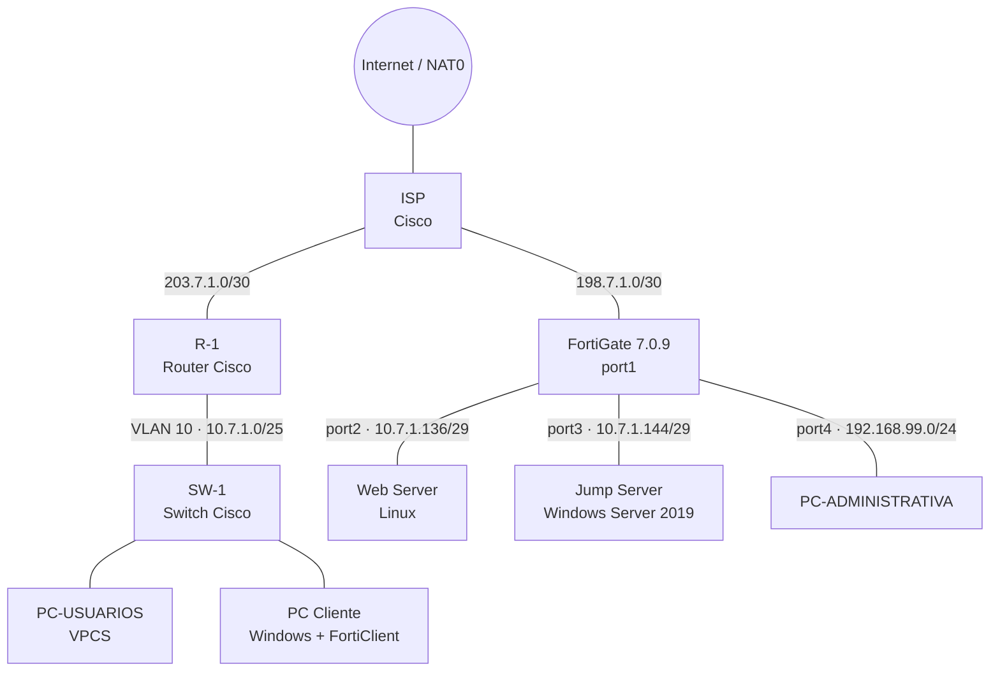

### Flujo de acceso

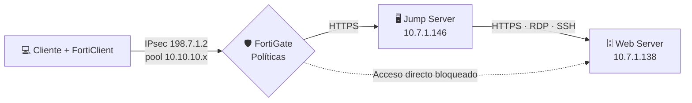

### Topología en GNS3

<div align="center">

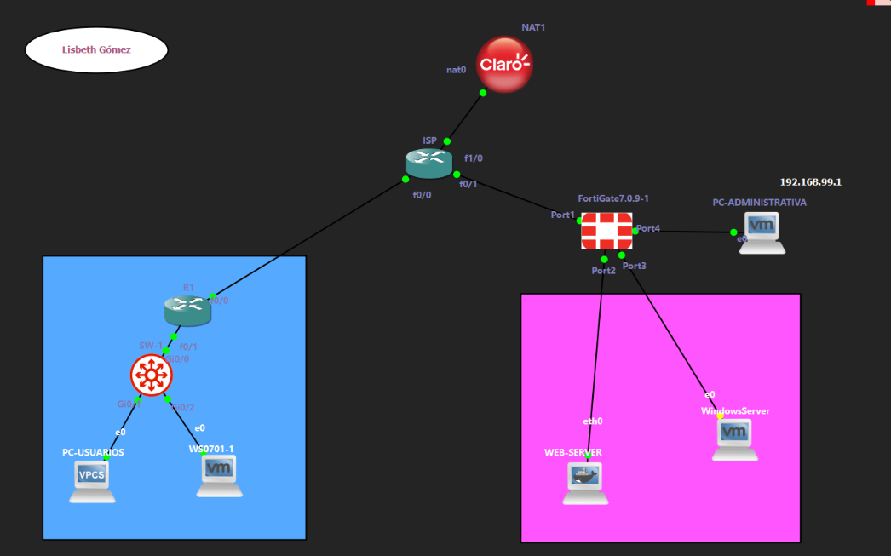

*📷 Imagen 01: topología completa en GNS3 con los nodos encendidos.*

</div>

### Tabla de direccionamiento

| 🌐 Red / enlace | Subred | Equipos |
|---|---|---|
| ISP ↔ R-1 | `203.7.1.0/30` | ISP `.1` · R-1 `.2` |
| ISP ↔ FortiGate (port1) | `198.7.1.0/30` | ISP `.1` · FortiGate `.2` |
| Usuarios VLAN 10 | `10.7.1.0/25` | R-1 `.1` · DHCP `.10` a `.126` |
| Web Server (port2) | `10.7.1.136/29` | FortiGate `.137` · servidor `.138` |
| Jump Server (port3) | `10.7.1.144/29` | FortiGate `.145` · servidor `.146` |
| Administración (port4) | `192.168.99.0/24` | FortiGate `.1` · PC-ADMINISTRATIVA |
| Clientes VPN | `10.10.10.10 – 10.10.10.50` | Asignadas por el FortiGate (modo config) |

---

## 4. 🧰 Equipos y cuentas

| Equipo | Sistema | Función |
|---|---|---|
| ISP | Cisco IOS | Proveedor de Internet y NAT hacia la nube |
| R-1 | Cisco IOS | Gateway de la VLAN 10, DHCP y NAT |
| SW-1 | Cisco IOS | Switch de la VLAN 10 |
| FortiGate | FortiOS 7.0.9 | Firewall y servidor VPN IPsec |
| Jump Server | Windows Server 2019 | Dominio `lab.local`, RDS RemoteApp y Web Client |
| Web Server | Linux (contenedor) | Sistema de Caja: HTTPS, SSH y RDP (xrdp) |
| PC Cliente | Windows 10 | FortiClient |
| PC-USUARIOS | VPCS | Prueba de DHCP en la VLAN 10 |
| PC-ADMINISTRATIVA | Windows | Administración del FortiGate por GUI |

| 👤 Cuenta | Ámbito | Uso |
|---|---|---|
| `usr-conpriv` / `usr-sinpriv` | FortiGate (grupo `GRP-VPN`) | Autenticación de la VPN |
| `LAB\conpriv` | Dominio `lab.local` (`GRP-CONPRIV`) | Usuario **con privilegios** en el Web Client |
| `LAB\sinpriv` | Dominio `lab.local` (`GRP-SINPRIV`) | Usuario **sin privilegios** en el Web Client |
| `rdpuser` | Web Server | Login de Putty y xrdp |

> [!NOTE]
> Las contraseñas del laboratorio no se publican en este repositorio.

---

## 5. 🌐 Configuración de los equipos Cisco

Todos los equipos llevan el banner con nombre y matrícula, acceso por SSH v2 y el usuario `Admin`.

### 5.1 ISP

<details>
<summary>📄 Ver comandos del ISP</summary>

```
! ============================================================
! ISP - Router Cisco
! Enlaces: R-1 (203.7.1.0/30), FortiGate port1 (198.7.1.0/30)
! ============================================================
enable
configure terminal
no ip domain-lookup
hostname ISP
banner motd #Lisbeth Gomez 2025-0701#
username Admin privilege 15 secret cisco
enable secret cisco
ip domain-name red.local
! IOS antiguos: usar "crypto key generate rsa" y escribir 2048 cuando pregunte los bits
crypto key generate rsa modulus 2048
ip ssh version 2
line console 0
 login local
 exit
line vty 0 4
 login local
 transport input ssh
 exit
interface f0/0
 description Enlace a R-1
 ip address 203.7.1.1 255.255.255.252
 ip nat inside
 speed 100
 duplex full
 no shutdown
interface f0/1
 description Enlace al FortiGate port1
 ip address 198.7.1.1 255.255.255.252
 ip nat inside
 speed 100
 duplex full
 no shutdown
interface f1/0
 description Salida a Internet (NAT0)
 ip address dhcp
 ip nat outside
 no shutdown
 exit
! --- Rutas hacia las redes internas ---
ip route 10.7.1.0 255.255.255.128 203.7.1.2
ip route 10.7.1.136 255.255.255.248 198.7.1.2
ip route 10.7.1.144 255.255.255.248 198.7.1.2
! --- NAT hacia la nube ---
access-list 1 permit 203.7.1.0 0.0.0.3
access-list 1 permit 198.7.1.0 0.0.0.3
ip nat inside source list 1 interface f1/0 overload
end
write memory
```

</details>

<div align="center">

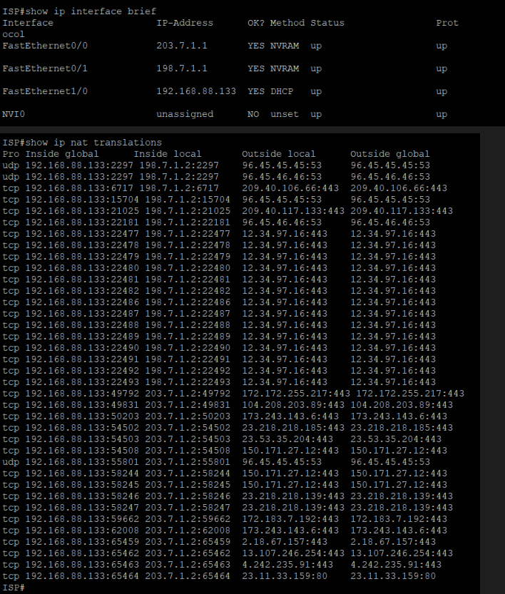

*📷 Imagen 02: `show ip interface brief` y `show ip nat translations` en el ISP.*

</div>

### 5.2 R-1 (gateway, DHCP y NAT)

<details>
<summary>📄 Ver comandos de R-1</summary>

```
! ============================================================
! R-1 - Router Cisco (gateway de la VLAN 10, DHCP y NAT)
! ============================================================
enable
configure terminal
no ip domain-lookup
hostname R-1
banner motd #Lisbeth Gomez 2025-0701#
username Admin privilege 15 secret cisco
enable secret cisco
ip domain-name red.local
! IOS antiguos: usar "crypto key generate rsa" y escribir 2048 cuando pregunte los bits
crypto key generate rsa modulus 2048
ip ssh version 2
line console 0
 login local
 exit
line vty 0 4
 login local
 transport input ssh
 exit
! --- DHCP VLAN 10 ---
ip dhcp excluded-address 10.7.1.1 10.7.1.9
ip dhcp pool VLAN10
 network 10.7.1.0 255.255.255.128
 default-router 10.7.1.1
 dns-server 8.8.8.8
 exit
! --- Interfaces ---
interface f0/0
 description Enlace al ISP
 ip address 203.7.1.2 255.255.255.252
 ip nat outside
 speed 100
 duplex full
 no shutdown
interface f0/1
 description Trunk hacia SW-1
 no ip address
 speed 100
 duplex full
 no shutdown
interface f0/1.10
 description VLAN 10 USUARIOS
 encapsulation dot1Q 10
 ip address 10.7.1.1 255.255.255.128
 ip nat inside
 exit
! --- Ruta por defecto y NAT ---
ip route 0.0.0.0 0.0.0.0 203.7.1.1
! El trafico hacia las LAN de los servidores NO se traduce
ip access-list extended NAT-VLAN10
 deny ip 10.7.1.0 0.0.0.127 10.7.1.136 0.0.0.7
 deny ip 10.7.1.0 0.0.0.127 10.7.1.144 0.0.0.7
 permit ip 10.7.1.0 0.0.0.127 any
 exit
ip nat inside source list NAT-VLAN10 interface f0/0 overload
end
write memory
```

</details>

<div align="center">

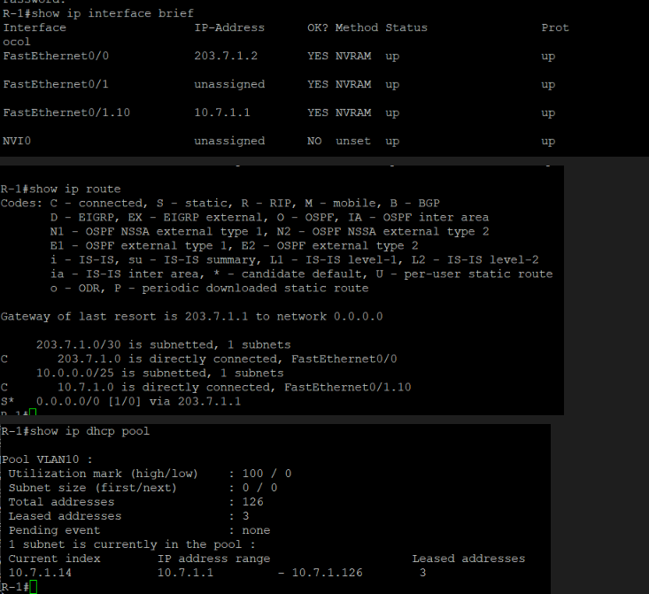

*📷 Imagen 03: `show ip interface brief`, `show ip route` y `show ip dhcp pool` en R-1.*

</div>

### 5.3 SW-1 (VLAN 10)

<details>
<summary>📄 Ver comandos de SW-1</summary>

```
! ============================================================
! SW-1 - Switch Cisco (VLAN 10 USUARIOS)
! ============================================================
enable
configure terminal
no ip domain-lookup
hostname SW-1
banner motd #Lisbeth Gomez 2025-0701#
username Admin privilege 15 secret cisco
enable secret cisco
ip domain-name red.local
crypto key generate rsa modulus 2048
ip ssh version 2
line console 0
 login local
 exit
line vty 0 4
 login local
 transport input ssh
 exit
vlan 10
 name USUARIOS
 exit
interface Gi0/0
 description Trunk hacia R-1
 switchport trunk encapsulation dot1q
 switchport mode trunk
 switchport trunk allowed vlan 10
 no shutdown
interface range Gi0/1 - 2
 description Puertos de usuarios
 switchport mode access
 switchport access vlan 10
 spanning-tree portfast
 no shutdown
 exit
end
write memory
```

</details>

<div align="center">

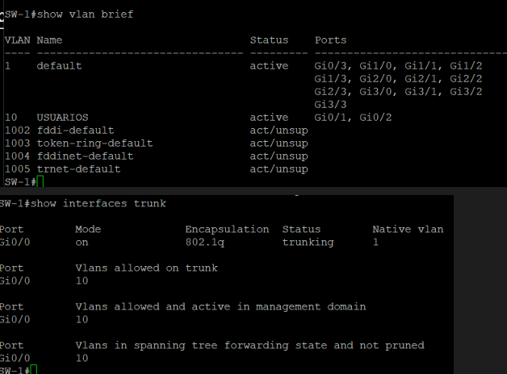

*📷 Imagen 04: `show vlan brief` y `show interfaces trunk` en SW-1.*

</div>

### 5.4 Verificación del DHCP

<div align="center">

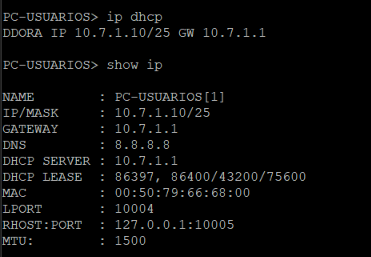

*📷 Imagen 05: `ip dhcp` y `show ip` en PC-USUARIOS (IP del rango `10.7.1.10 – 10.7.1.126`).*

</div>

---

## 6. 🛡️ Configuración del FortiGate (GUI)

### 6.1 Acceso inicial (único paso por CLI)

```
# ============================================================
# FortiGate - unico paso por CLI: dar acceso a la GUI por port4
# Todo lo demas se configura y demuestra por GUI
# ============================================================
config system interface
  edit port4
    set mode static
    set ip 192.168.99.1 255.255.255.0
    set allowaccess https http ping ssh
  next
end

# En PC-ADMINISTRATIVA: IP 192.168.99.x/24 y abrir http://192.168.99.1
```

<div align="center">

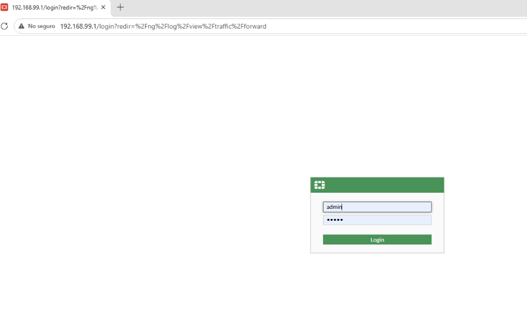

*📷 Imagen 06: inicio de sesión de la GUI en `192.168.99.1`.*

</div>

### 6.2 Interfaces

**Network → Interfaces**

| Interfaz | IP | Rol | Acceso administrativo |
|---|---|---|---|
| `port1` | `198.7.1.2/30` | WAN | PING |
| `port2` | `10.7.1.137/29` | LAN (Web Server) | PING |
| `port3` | `10.7.1.145/29` | LAN (Jump Server) | PING |
| `port4` | `192.168.99.1/24` | LAN (administración, PC-ADMINISTRATIVA) | HTTPS, HTTP, PING, SSH |

<div align="center">

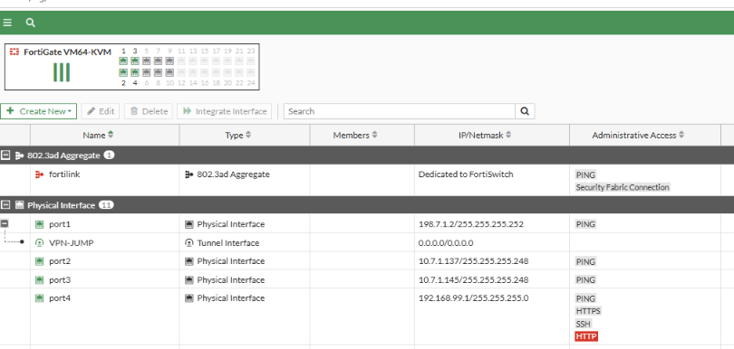

*📷 Imagen 07: lista de interfaces en **Network → Interfaces**.*

</div>

### 6.3 Ruta por defecto

**Network → Static Routes → Create New**

| Destino | Gateway | Interfaz | Para qué |
|---|---|---|---|
| `0.0.0.0/0` | `198.7.1.1` | `port1` | Ruta por defecto hacia el ISP |
| `10.7.1.0/25` | `198.7.1.1` | `port1` | Ruta de vuelta hacia la VLAN 10 |

<div align="center">

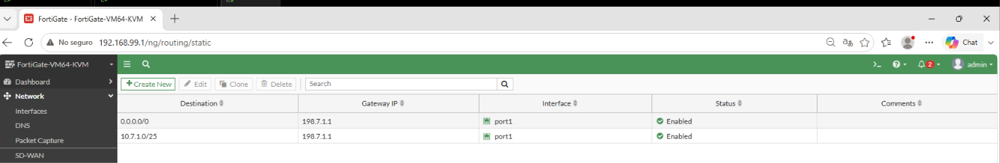

*📷 Imagen 08: tabla de **Static Routes**.*

</div>

### 6.4 Objetos de dirección

**Policy & Objects → Addresses**

| Nombre | Tipo | Valor |
|---|---|---|
| `Jump-Server` | Subnet | `10.7.1.146/32` |
| `Web-Server` | Subnet | `10.7.1.138/32` |
| `NET-VLAN10` | Subnet | `10.7.1.0/25` |

Además, el asistente IPsec genera los objetos del rango de clientes y de las redes accesibles (*split tunnel*).

<div align="center">

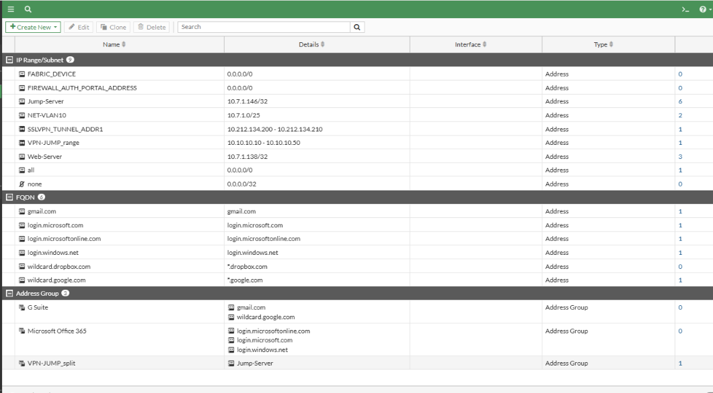

*📷 Imagen 09: lista de **Addresses**.*

</div>

### 6.5 Usuarios y grupo de la VPN

**User & Authentication**

| Elemento | Valor |
|---|---|
| Usuarios locales | `usr-conpriv`, `usr-sinpriv` |
| Grupo | `GRP-VPN` (contiene `usr-conpriv` y `usr-sinpriv`) |

<div align="center">

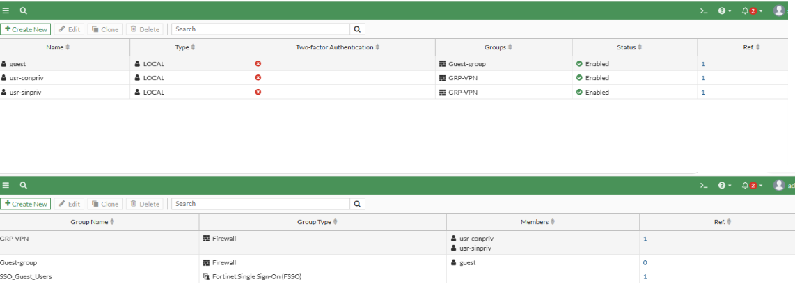

*📷 Imagen 10: **User Definition** y **User Groups**.*

</div>

### 6.6 Túnel VPN IPsec (asistente *Remote Access – FortiClient*)

**VPN → IPsec Wizard**

| Paso | Parámetro | Valor |
|---|---|---|
| 1. VPN Setup | Name | `VPN-JUMP` |
| 1. VPN Setup | Template type | Remote Access · Client: FortiClient |
| 2. Authentication | Incoming Interface | `port1` |
| 2. Authentication | Authentication method | Pre-shared Key |
| 2. Authentication | User Group | `GRP-VPN` |
| 3. Policy & Routing | Client address range | `10.10.10.10 – 10.10.10.50` (máscara `255.255.255.0`) |
| 3. Policy & Routing | Split tunnel | Habilitado, red accesible: `Jump-Server` |
| 3. Policy & Routing | Use system DNS | Habilitado |
| 3. Policy & Routing | Local Interface / Local Address | `port3` / `Jump-Server` |
| 3. Policy & Routing | Allow Endpoint Registration | Desactivado |
| 3. Policy & Routing | Dead Peer Detection | On Demand (3 reintentos, 20 s) |

#### Propuestas de cifrado (túnel convertido a personalizado)

En esta imagen del FortiGate el desplegable de cifrado solo ofrece **DES**, por lo que ambos extremos usan DES. Deben coincidir exactamente en el FortiGate y en FortiClient:

| Parámetro | FortiGate | FortiClient |
|---|---|---|
| IKE / modo | Versión 1 / Aggressive | Versión 1 / Agresivo |
| Fase 1 | DES · SHA256 · DH 14 y 5 | DES · SHA256 · DH 14 y 5 |
| NAT Traversal | Habilitado | Habilitado |
| XAuth | Auto Server · grupo `GRP-VPN` | Habilitado · usuario `usr-conpriv` |
| Fase 2 | DES-SHA256 y DES-MD5 | DES-SHA256 y DES-MD5 |
| PFS | Habilitado · DH 14 y 5 | Habilitado · **DH 14** |

> [!NOTE]
> NAT-T es necesario porque R-1 traduce al cliente (`203.7.1.2`) antes de llegar al FortiGate.

<div align="center">

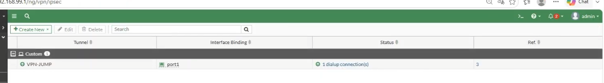

*📷 Imagen 11: asistente IPsec, paso **VPN Setup**.*

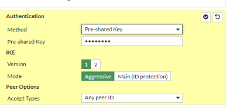

*📷 Imagen 12: asistente IPsec, paso **Authentication**.*

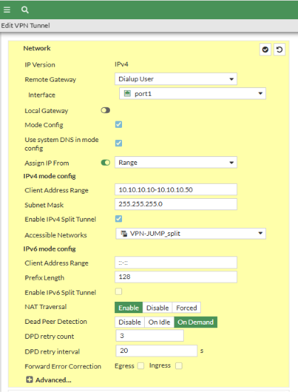

*📷 Imagen 13: asistente IPsec, paso **Policy & Routing** (rango de clientes y *split tunnel*).*

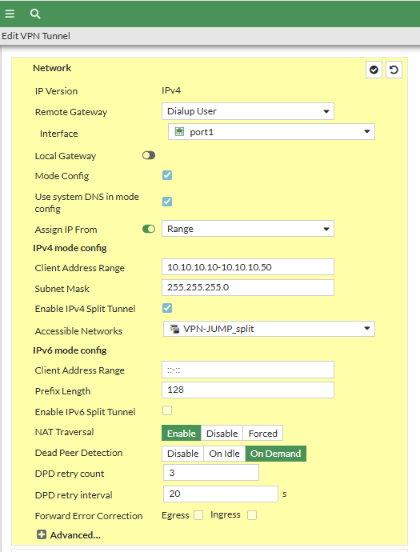

*📷 Imagen 14: **VPN → IPsec Tunnels** con el túnel `VPN-JUMP`.*

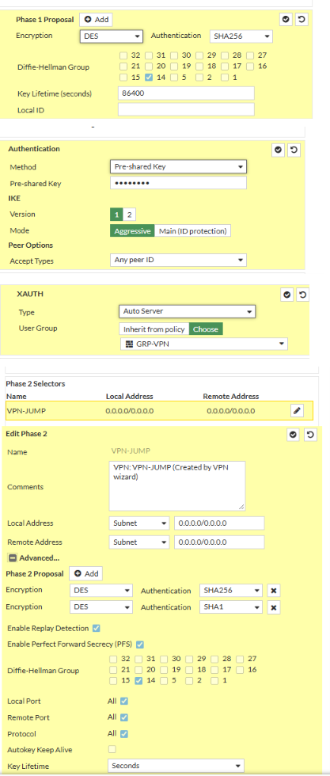

*📷 Imagen 35: propuestas de **Phase 1** y **Phase 2** del túnel.*

</div>

### 6.7 Políticas de firewall

**Policy & Objects → Firewall Policy** (vista *By Sequence*, NAT desactivado en todas):

| # | Política | Entrada | Salida | Origen | Destino | Servicio | Acción |
|---|---|---|---|---|---|---|---|
| 1 | `DENY-SSH-VPN` | `VPN-JUMP` | `port2`, `port3` | `all` | `Jump-Server`, `Web-Server` | SSH | ⛔ **DENY** |
| 2 | `vpn_VPN-JUMP_remote_0` (generada por el asistente) | `VPN-JUMP` | `port3` | Rango de clientes VPN | `Jump-Server` | HTTPS | ✅ ACCEPT |
| 3 | `DENY-SSH-VLAN10` | `port1` | `port2`, `port3` | `NET-VLAN10` | `Jump-Server`, `Web-Server` | SSH | ⛔ **DENY** |
| 4 | `VLAN10-to-JUMP` | `port1` | `port3` | `NET-VLAN10` | `Jump-Server` | HTTPS | ✅ ACCEPT |
| 5 | `JUMP-WEB` | `port3` | `port2` | `Jump-Server` | `Web-Server` | HTTPS, RDP, SSH | ✅ ACCEPT |

Todas con *Log Allowed Traffic → All Sessions*. Las dos políticas **DENY** cumplen el requisito de restricción explícita del SSH para el usuario sin privilegios.

> [!TIP]
> La VPN no tiene ninguna política hacia `port2`: el Web Server solo es alcanzable desde el Jump Server. El resto del tráfico cae en el *deny* implícito.

<div align="center">


*📷 Imagen 15: lista **Firewall Policy** en vista *By Sequence*.*

</div>

---

## 7. 🗄️ Configuración del Web Server

Contenedor Linux (Ubuntu 22.04) con la IP fija del nodo y tres servicios: **Apache (HTTPS 443)**, **OpenSSH (22)** y **xrdp (3389)**.

> [!WARNING]
> En GNS3 este contenedor se reconstruye desde la imagen base cuando se detiene. Lo instalado con `apt` y los servicios en ejecución se pierden. Se debe usar **Suspend** y repetir la instalación si se recrea.

La instalación de paquetes requiere salida temporal a internet: una política en el FortiGate `port2 → port1` con NAT, y el ISP permitiendo `198.7.1.0/30` en su ACL de NAT. Se elimina al terminar.

<details>
<summary>📄 Ver comandos del Web Server</summary>

```
# ============================================================
# Web Server (contenedor Linux en GNS3)
# ============================================================

# --- 1. Red: Network configuration del nodo (Edit config en GNS3) ---
auto eth0
iface eth0 inet static
  address 10.7.1.138
  netmask 255.255.255.248
  gateway 10.7.1.137
  up echo "nameserver 8.8.8.8" > /etc/resolv.conf

# Equivalente inmediato por consola (se pierde al reiniciar)
ip addr flush dev eth0
ip addr add 10.7.1.138/29 dev eth0
ip link set eth0 up
ip route add default via 10.7.1.137
echo "nameserver 8.8.8.8" > /etc/resolv.conf

# --- 2. Paquetes (requiere salida temporal a internet) ---
apt update
apt install -y openssh-server xrdp apache2 dbus-x11 openbox xterm

# --- 3. HTTPS y pagina del Sistema de Caja ---
a2enmod ssl
a2ensite default-ssl
echo "<h1>Sistema de Caja</h1>" > /var/www/html/index.html
service apache2 restart

# --- 4. Usuario para Putty y xrdp (definir una contrasena) ---
useradd -m -s /bin/bash rdpuser
passwd rdpuser

# --- 5. Escritorio minimo para la sesion RDP ---
echo "openbox-session" > /home/rdpuser/.xsession
chown rdpuser:rdpuser /home/rdpuser/.xsession
chmod +x /home/rdpuser/.xsession

# --- 6. Arranque de servicios ---
mkdir -p /run/sshd
ssh-keygen -A
/usr/sbin/sshd
service apache2 start
service xrdp restart

# --- 7. Verificacion ---
ip addr show eth0
ip route
netstat -ln | grep -E ":22|:443|:3389"
id rdpuser
```

</details>

<div align="center">

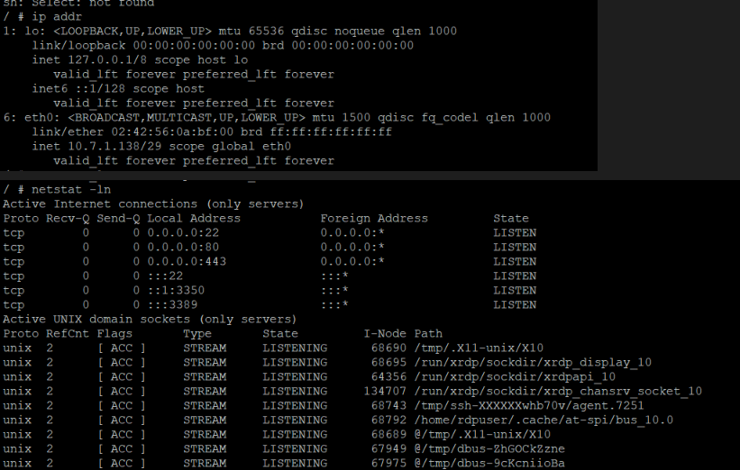

*📷 Imagen 16: `ip addr` y `ss -tln` en el Web Server (puertos 443, 22 y 3389 en escucha).*

</div>

---

## 8. 🖥️ Configuración del Jump Server

Windows Server 2019 con la IP `10.7.1.146/29`, promovido a controlador de dominio (`lab.local`) para poder desplegar **Remote Desktop Services**.

<details>
<summary>📄 Ver script completo del Jump Server (PowerShell)</summary>

```powershell
# ============================================================
# Jump Server - Windows Server 2019 (PowerShell como administrador)
# ============================================================

# ---------- 1. Red ----------
New-NetIPAddress -InterfaceAlias "Ethernet0 2" -IPAddress 10.7.1.146 -PrefixLength 29 -DefaultGateway 10.7.1.145
Set-DnsClientServerAddress -InterfaceAlias "Ethernet0 2" -ServerAddresses 127.0.0.1
Rename-Computer -NewName JUMP -Restart

# ---------- 2. Active Directory (dominio lab.local) ----------
Install-WindowsFeature AD-Domain-Services -IncludeManagementTools
Install-ADDSForest -DomainName lab.local -InstallDns

# ---------- 3. Usuarios y grupos del dominio ----------
$p = Read-Host "Contrasena para sinpriv y conpriv" -AsSecureString
New-ADUser -Name sinpriv -SamAccountName sinpriv -AccountPassword $p -Enabled $true
New-ADUser -Name conpriv -SamAccountName conpriv -AccountPassword $p -Enabled $true
New-ADGroup -Name GRP-SINPRIV -GroupScope Global
New-ADGroup -Name GRP-CONPRIV -GroupScope Global
Add-ADGroupMember GRP-SINPRIV sinpriv
Add-ADGroupMember GRP-CONPRIV conpriv

# ---------- 4. Remote Desktop Services ----------
# Despliegue estandar por Administrador del servidor:
# Agregar roles y caracteristicas > Servicios de Escritorio remoto > Implementacion estandar >
# Implementacion basada en sesiones > Agente de conexion, Acceso web y Host de sesion en JUMP.lab.local
Get-RDServer

# ---------- 5. Coleccion y RemoteApps ----------
New-RDSessionCollection -CollectionName COL-JUMP -SessionHost JUMP.lab.local -ConnectionBroker JUMP.lab.local
Set-RDSessionCollectionConfiguration -CollectionName COL-JUMP -UserGroup "LAB\GRP-SINPRIV","LAB\GRP-CONPRIV" -ConnectionBroker JUMP.lab.local

New-RDRemoteApp -CollectionName COL-JUMP -DisplayName "Navegador" -FilePath "C:\Program Files\Mozilla Firefox\firefox.exe" -UserGroups "LAB\GRP-SINPRIV","LAB\GRP-CONPRIV" -ConnectionBroker JUMP.lab.local
New-RDRemoteApp -CollectionName COL-JUMP -DisplayName "RDP" -FilePath "C:\Windows\System32\mstsc.exe" -UserGroups "LAB\GRP-CONPRIV" -ConnectionBroker JUMP.lab.local
New-RDRemoteApp -CollectionName COL-JUMP -DisplayName "Putty" -FilePath "C:\Program Files\PuTTY\putty.exe" -UserGroups "LAB\GRP-CONPRIV" -ConnectionBroker JUMP.lab.local
Get-RDRemoteApp -CollectionName COL-JUMP -ConnectionBroker JUMP.lab.local | Select Alias, DisplayName, UserGroups

# ---------- 6. Derecho de inicio de sesion remoto (controlador de dominio) ----------
# gpmc.msc > Domain Controllers > Default Domain Controllers Policy > Editar:
# Directivas locales > Asignacion de derechos de usuario:
#   - Permitir el inicio de sesion local
#   - Permitir inicio de sesion a traves de Servicios de Escritorio remoto
# Agregar LAB\GRP-SINPRIV, LAB\GRP-CONPRIV y Administradores
gpupdate /force

# ---------- 7. Certificado y RD Gateway ----------
$cert = New-SelfSignedCertificate -DnsName "JUMP.lab.local","10.7.1.146" -CertStoreLocation Cert:\LocalMachine\My -NotAfter (Get-Date).AddYears(2)
$pw = Read-Host "Contrasena del PFX" -AsSecureString
Export-PfxCertificate -Cert $cert -FilePath C:\jump.pfx -Password $pw
Export-Certificate -Cert $cert -FilePath C:\cert.cer
Import-Certificate -FilePath C:\cert.cer -CertStoreLocation Cert:\LocalMachine\Root
Add-RDServer -Server JUMP.lab.local -Role RDS-GATEWAY -ConnectionBroker JUMP.lab.local -GatewayExternalFqdn JUMP.lab.local
Set-RDCertificate -Role RDPublishing -ImportPath C:\jump.pfx -Password $pw -ConnectionBroker JUMP.lab.local -Force
Set-RDCertificate -Role RDRedirector -ImportPath C:\jump.pfx -Password $pw -ConnectionBroker JUMP.lab.local -Force
Set-RDCertificate -Role RDWebAccess  -ImportPath C:\jump.pfx -Password $pw -ConnectionBroker JUMP.lab.local -Force
Set-RDCertificate -Role RDGateway    -ImportPath C:\jump.pfx -Password $pw -ConnectionBroker JUMP.lab.local -Force
Get-RDCertificate -ConnectionBroker JUMP.lab.local

# ---------- 8. RemoteApp Web Client ----------
[Net.ServicePointManager]::SecurityProtocol = [Net.SecurityProtocolType]::Tls12
# Modulo RDWebClientManagement (descarga directa desde PowerShell Gallery)
$dest = "$env:ProgramFiles\WindowsPowerShell\Modules\RDWebClientManagement"
New-Item -ItemType Directory -Path $dest -Force | Out-Null
Invoke-WebRequest -Uri "https://www.powershellgallery.com/api/v2/package/RDWebClientManagement" -OutFile "$env:TEMP\rdwc.zip" -UseBasicParsing
Expand-Archive -Path "$env:TEMP\rdwc.zip" -DestinationPath $dest -Force
Import-Module RDWebClientManagement
Install-RDWebClientPackage
Import-RDWebClientBrokerCert C:\cert.cer
Publish-RDWebClientPackage -Type Production -Latest
Get-RDWebClientPackage

# ---------- 9. PuTTY ----------
New-Item -ItemType Directory -Path "C:\Program Files\PuTTY" -Force | Out-Null
Invoke-WebRequest -Uri "https://the.earth.li/~sgtatham/putty/latest/w64/putty.exe" -OutFile "C:\Program Files\PuTTY\putty.exe" -UseBasicParsing

# ---------- 10. Verificacion hacia el Web Server ----------
Test-NetConnection 10.7.1.138 -Port 443
Test-NetConnection 10.7.1.138 -Port 22
Test-NetConnection 10.7.1.138 -Port 3389
Test-NetConnection 10.7.1.138 -Port 80
```

</details>

> [!NOTE]
> El *Navegador* publicado es **Firefox** (`C:\Program Files\Mozilla Firefox\firefox.exe`), porque Internet Explorer no abre bien sitios HTTPS actuales. Como el Jump no tiene salida a internet, el instalador completo de Firefox se copia desde el equipo anfitrión y se instala con `Start-Process "<ruta>\Firefox Setup.exe" -ArgumentList "/S" -Wait`. El cliente web HTML5 se abre desde Edge, Chrome o Firefox en el PC cliente, nunca desde Internet Explorer.

### 8.1 Aplicaciones publicadas por grupo

| 📦 Aplicación | `GRP-SINPRIV` | `GRP-CONPRIV` |
|---|:---:|:---:|
| Navegador (Firefox) | ✅ | ✅ |
| RDP (`mstsc`) | ❌ | ✅ |
| Putty | ❌ | ✅ |

### 8.2 Evidencias

<div align="center">

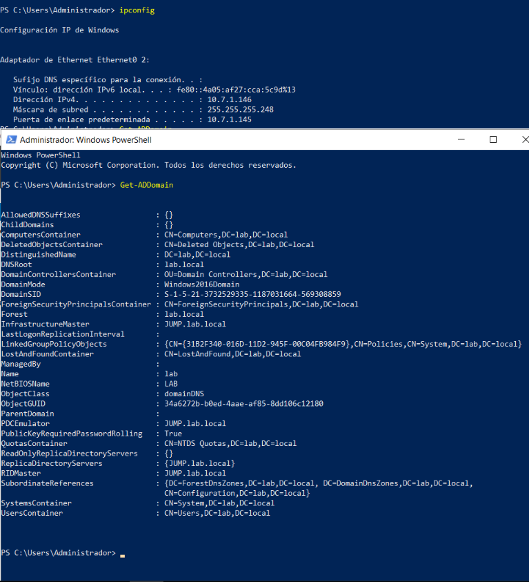

*📷 Imagen 17: `ipconfig` y `Get-ADDomain` en el Jump Server.*

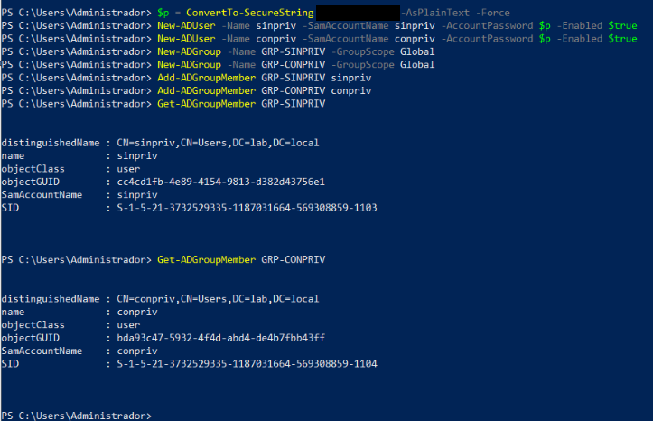

*📷 Imagen 18: miembros de `GRP-SINPRIV` y `GRP-CONPRIV`.*

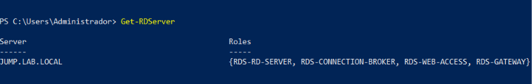

*📷 Imagen 19: `Get-RDServer` con los roles Connection Broker, Web Access, Session Host y Gateway.*

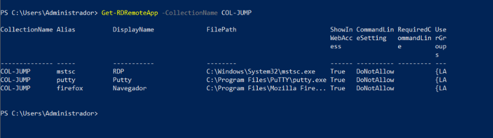

*📷 Imagen 20: `Get-RDRemoteApp` con Navegador, RDP y Putty y sus grupos.*

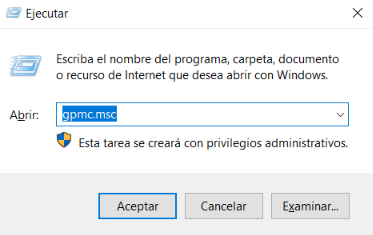

*📷 Imagen 21: directiva *Permitir inicio de sesión a través de Servicios de Escritorio remoto*.*

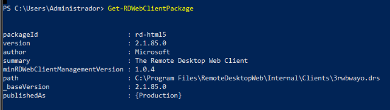

*📷 Imagen 22: `Get-RDWebClientPackage` con `publishedAs : {Production}`.*

</div>

---

## 9. 💻 Cliente VPN (FortiClient)

**Nueva conexión VPN → pestaña VPN IPsec**

| Campo | Valor |
|---|---|
| Nombre de conexión | `VPN-JUMP` |
| Gateway remoto | `198.7.1.2` |
| Método de autenticación | Pre-shared Key (la definida en el asistente) |
| Autenticación (XAuth) | Preguntar en el login |
| Usuario | `usr-conpriv` / `usr-sinpriv` |
| IKE / modo | Versión 1 / Agresivo |
| Fase 1 | DES · SHA256 · DH 14 y 5 · NAT Traversal |
| Fase 2 | DES-SHA256 y DES-MD5 · PFS con DH 14 |

<div align="center">


*📷 Imagen 23: conexión IPsec en FortiClient.*


*📷 Imagen 36: ajustes avanzados de FortiClient (fases 1 y 2).*

</div>

---

## 10. 🧪 Pruebas de validación

Comandos: [`07-Verificacion-cliente.ps1`](scripts/07-Verificacion-cliente.ps1) y [`08-Verificacion-Jump-Web.ps1`](scripts/08-Verificacion-Jump-Web.ps1).

### 10.1 Resumen

| # | Prueba | Desde | Resultado esperado |
|---|---|---|---|
| 1 | DHCP en la VLAN 10 | PC-USUARIOS | IP del rango `10.7.1.10 – .126` |
| 2 | SSH al Jump y al Web Server **sin VPN** | PC Cliente | ⛔ Bloqueado |
| 3 | Conexión IPsec con FortiClient | PC Cliente | Adaptador con IP `10.10.10.x` |
| 4 | HTTPS al Jump Server con la VPN | PC Cliente | ✅ Permitido |
| 5 | SSH al Jump Server con la VPN | PC Cliente | ⛔ Bloqueado |
| 6 | HTTPS al Web Server con la VPN | PC Cliente | ⛔ Bloqueado |
| 7 | Web Client con `LAB\sinpriv` | PC Cliente | Solo *Navegador* |
| 8 | Web Client con `LAB\conpriv` | PC Cliente | *Navegador*, *Putty* y *RDP* |
| 9 | Putty y RDP al Web Server (`rdpuser`) | Web Client | ✅ SSH y escritorio xrdp |
| 10 | 22, 443 y 3389 del Jump al Web Server | Jump Server | ✅ Permitidos |
| 11 | Puerto 80 del Jump al Web Server | Jump Server | ⛔ Bloqueado |

### 10.2 Evidencias

**A. Con la VPN desconectada**

<div align="center">

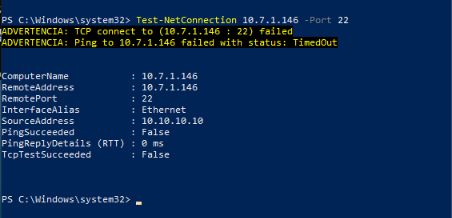

*📷 Imagen 24: `Test-NetConnection` por SSH al Jump y al Web Server sin VPN.*

</div>

**B. Conexión de la VPN**

<div align="center">


*📷 Imagen 25: FortiClient conectado y `ipconfig` con el adaptador `10.10.10.x`.*

<div align="center">

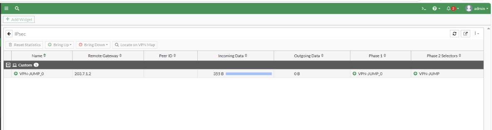

*📷 Imagen 26: túnel activo en el FortiGate (**VPN Events** o **Dashboard**).*


</div>

**C. Pruebas con la VPN activa**

<div align="center">

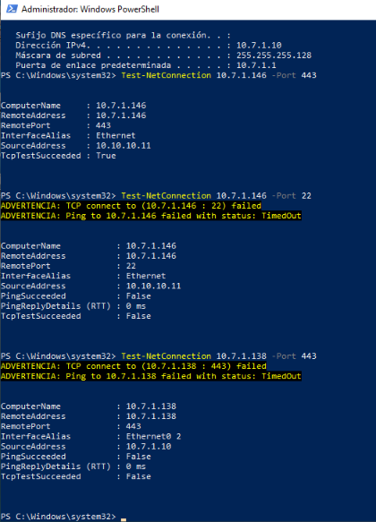

*📷 Imagen 27: HTTPS al Jump (permitido), SSH al Jump y HTTPS al Web Server (bloqueados).*

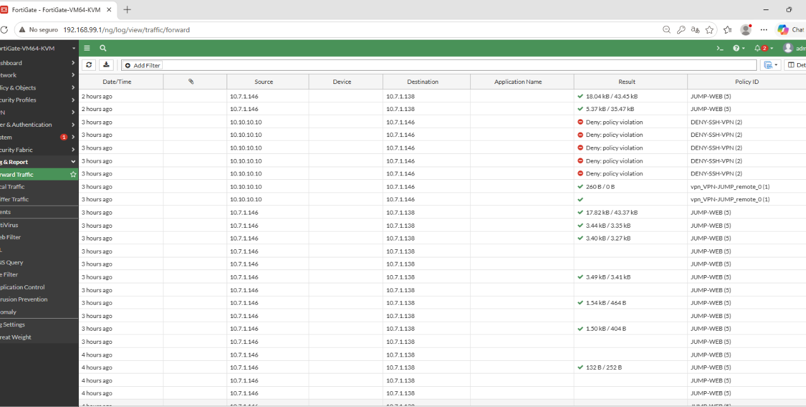

*📷 Imagen 37: **Forward Traffic** con el SSH del cliente VPN (`10.10.10.10`) bloqueado por `DENY-SSH-VPN` y el tráfico permitido por `vpn_VPN-JUMP_remote_0` y `JUMP-WEB`.*

</div>

**D. Web Client por tipo de usuario**

<div align="center">

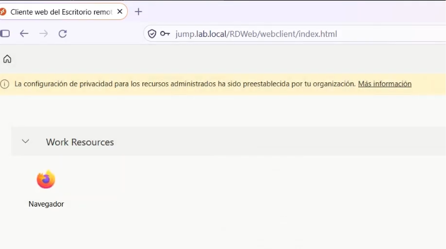

*📷 Imagen 28: `LAB\sinpriv`, solo *Navegador*.*

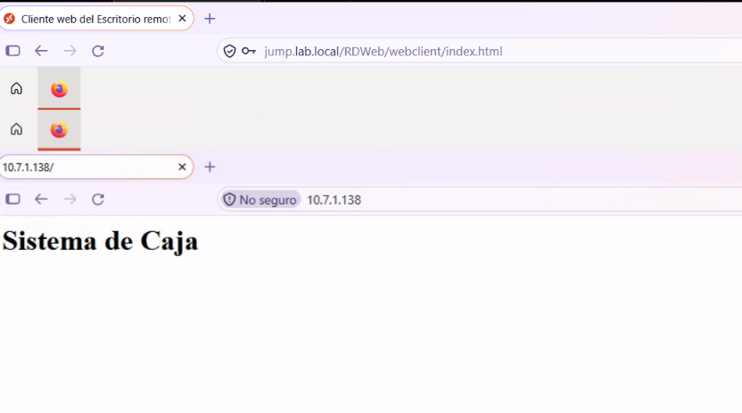

*📷 Imagen 29: *Navegador* abriendo `https://10.7.1.138` (Sistema de Caja).*

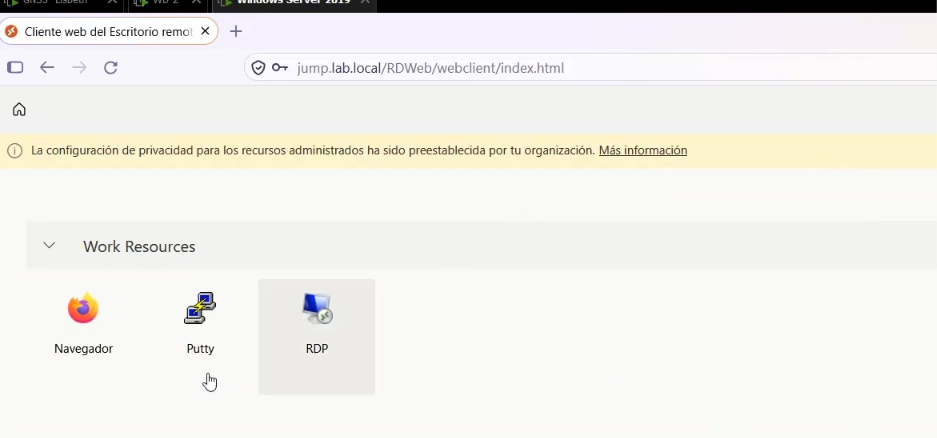

*📷 Imagen 30: `LAB\conpriv`, con *Navegador*, *Putty* y *RDP*.*

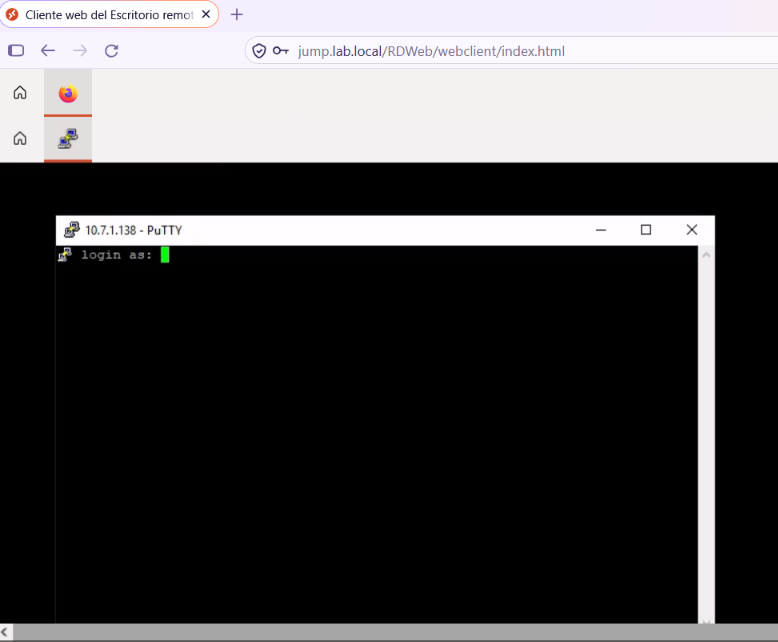

*📷 Imagen 31: *Putty* al Web Server (`10.7.1.138`, puerto 22).*

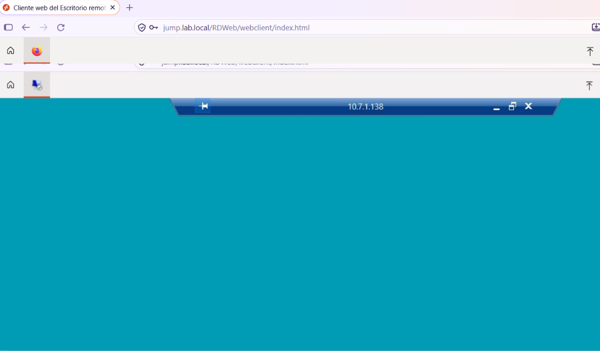

*📷 Imagen 32: *RDP* al Web Server (login de xrdp).*

</div>

**E. Jump Server hacia el Web Server**

<div align="center">

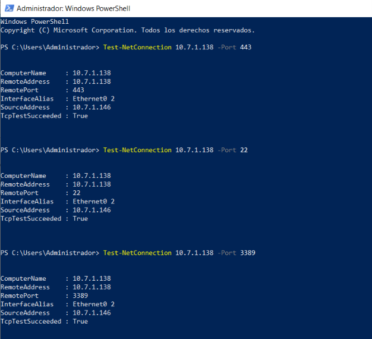


*📷 Imagen 33: 22, 443 y 3389 permitidos; 80 bloqueado.*

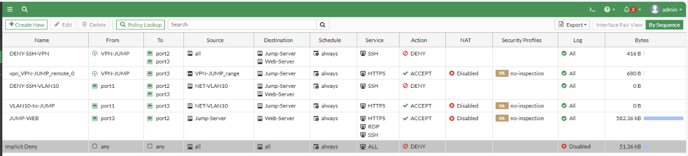

*📷 Imagen 34: **Firewall Policy** con contadores de tráfico y bloqueos.*

</div>

---

## 11. ⚠️ Adaptaciones y limitaciones

| Tema | Detalle |
|---|---|
| Cifrado IPsec | El FortiGate-VM solo ofrece DES en el desplegable de cifrado, por lo que fases 1 y 2 usan DES |
| NAT-T | R-1 traduce al cliente, por lo que se usa UDP 500/4500 con NAT Traversal |
| Web Server | Contenedor que se reconstruye al detenerse: usar *Suspend* y reinstalar servicios si se recrea |
| Salida a internet | Solo temporal para instalar paquetes; las políticas temporales se eliminan |
| Pruebas con ICMP | Las políticas no permiten ICMP; las pruebas se hacen con `Test-NetConnection -Port` |
| CLI del FortiGate | Solo para el acceso inicial por `port4`; la configuración y la demostración son por GUI |

---

## 12. 📁 Estructura del repositorio

```
.
├── README.md                    # Documentación completa (este archivo)
├── images/                      # Capturas y miniatura del video
├── scripts/                     # Comandos y scripts utilizados
│   ├── 01-ISP.txt
│   ├── 02-R-1.txt
│   ├── 03-SW-1.txt
│   ├── 04-FortiGate-acceso-inicial.txt
│   ├── 05-Web-Server.txt
│   ├── 06-Jump-Server.ps1
│   ├── 07-Verificacion-cliente.ps1
│   └── 08-Verificacion-Jump-Web.ps1
└── running-configs/             # Exportación de la configuración de cada equipo
    ├── ISP_running-config.txt
    ├── R-1_running-config.txt
    ├── SW-1_running-config.txt
    ├── FortiGate_running-config.txt
    └── WebServer_config.txt
```

---

## 13. 💾 Running-configs

Exportación de la configuración de cada equipo en archivos individuales:

| Equipo | Archivo | Cómo se exporta |
|---|---|---|
| ISP | [`ISP_running-config.txt`](running-configs/ISP_running-config.txt) | `show running-config` |
| R-1 | [`R-1_running-config.txt`](running-configs/R-1_running-config.txt) | `show running-config` |
| SW-1 | [`SW-1_running-config.txt`](running-configs/SW-1_running-config.txt) | `show running-config` |
| FortiGate | [`FortiGate_running-config.txt`](running-configs/FortiGate_running-config.txt) | GUI: **admin → Configuration → Backup** |
| Web Server | [`WebServer_config.txt`](running-configs/WebServer_config.txt) | Salida de `ip addr`, `netstat` y archivos de configuración |

---

<div align="center">

🎓 Laboratorio realizado por **Lisbeth Gómez** · 2025-0701

</div>
